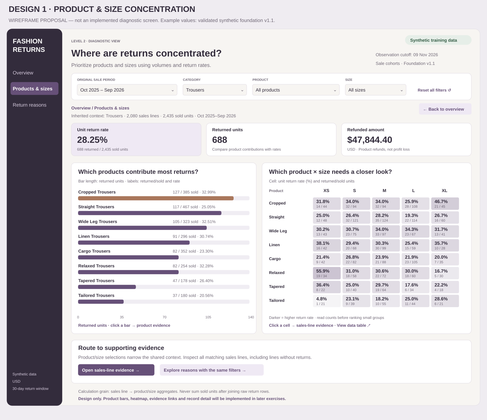
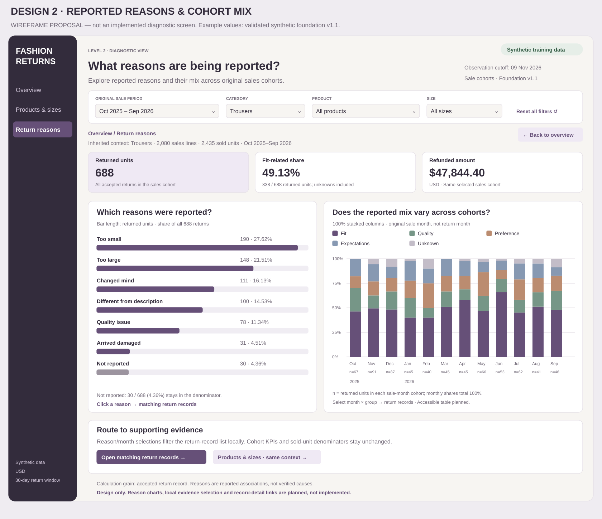
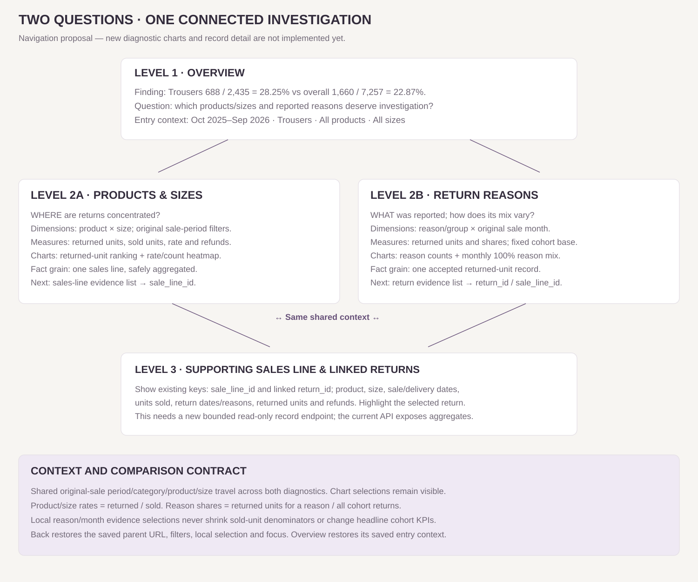

# Block 03 Exercise 01 — Two complementary diagnostic investigations

Design checkpoint only. These PNGs are wireframe proposals, not implemented diagnostic screens. The existing app already has initial aggregate Products & sizes and Return reasons tables; the new ranking/heatmap/reason-mix charts and supporting record drilldowns remain to be built. No application or database changes were made for this design exercise.

## Audience, trigger and selection

An e-commerce manager prioritizes products and sizes for review of size guides, descriptions or quality. Overview finding in the approved synthetic foundation v1.1: Trousers has688 returned /2435 sold =28.254620%, versus1660/7257 =22.874466% overall. The difference is5.380154 percentage points; it is descriptive, not proof of a cause. Inherited example period: original sale dates2025-10-01 through2026-09-30; categoryTrousers; all products/sizes; fixed observation cutoff2026-11-09 and completed30-day windows.

Candidate investigations considered: product/size concentration; reported reasons with reason-mix variation across sale cohorts; and a delivery-lag association view using sale/delivery dates. I recommend the first two because they directly support the product/size review decision and use the existing agreed navigation. Delivery lag is deferred; the data contains no carrier or operational-process detail. A separate return-rate-only time view was also rejected because the overview already provides it.

## View-to-question map

View2A, Products & sizes: WHERE are returned units concentrated, and which product/size combinations have elevated rates? Supports prioritization using both volume and rates.

View2B, Return reasons & cohort mix: WHAT reasons were reported, and does their composition vary across original sale-month cohorts? Supports formulation of hypotheses for investigation. It does not establish why returns happened.

Both use the same inherited original-sale period/category/product/size, visible context, units and metric definitions. They answer different questions rather than repeat one chart with a new title.

## View2A — Products & sizes

Source fields: cohort_context.sale_line_id, sale_date, product_id, product_name, category, size, units_sold, returned_units, refund_usd. product_name/category come from products; size from variants; time from sale_date. Fact grain stays one eligible delivered sales line. Returns are already aggregated per line before joining sales. The app's existing API exposes disjoint sale-month/product/size aggregates, which can be summed safely.

ChartA1: horizontal bars ranked by returned units. Question: which products contribute most returned units? Encoding: bar length=SUM(returned_units), axis in units, descending order; labels show returned/sold counts and return rate(%). Example CroppedTrousers127/385=32.99%; StraightTrousers117/467=25.05%. This distinguishes return volume from propensity; a large-volume style is not necessarily the highest-rate style. Comparisons are between products within the selected cohort, with denominators shown.

ChartA2: product×size heatmap. Question: which combinations need closer examination? Encoding: row=product, column=XS/S/M/L/XL, color=unit return rate, text=rate plus returned/sold counts. Aggregate grain=product×size across the selected sale period. Rate=SUM(returned_units)/NULLIF(SUM(units_sold),0); recompute ratios, never average percentages. Small denominators remain visible; no arbitrary exclusion threshold is introduced. Provide a keyboard-operable table alternative. Heatmap labels use one decimal for space; tooltips/table use two, with exact counts.

Headline context: return rate, returned units and refunded amount in USD for the full selected cohort. Refunds are product refunds, not profit loss. Empty additive totals are0; a zero sold-unit denominator isN/A.

Interactions: selecting a bar or cell visibly narrows product and/or size in shared context and offers the matching sales-line evidence list, including non-returned sales needed to understand the denominator. Cross-view action sends the same period/category/product/size to Return reasons. Supporting rows include sale_line_id, sale/delivery dates, product/size, units_sold, returned_units and refunds. Selecting sale_line_id opens Level3 detail.

## View2B — Return reasons & cohort mix

Source fields: return_detail.return_id, sale_line_id, sale_date, return_date, variant_id, reason_code, returned_units, refund_usd; return_reasons.reason_label/reason_group; variants/product dimensions. Fact grain=one accepted returned-unit record. Use only returns linked to eligible sales lines, with original sale dates in the inherited period and returns1–30days after delivery by the observation cutoff. No sold-unit measures are summed at return-record grain.

ChartB1: horizontal reason-count bars. Question: what reasons characterize the selected cohort's accepted returns? Encoding: length=SUM(returned_units) by reason; labels=count and share of ALL returned units in the selected cohort. In the example TooSmall190/688=27.62%, TooLarge148/688=21.51%, NotReported30/688=4.36%. Unknown reasons remain a visible category and remain in every all-return denominator.

ChartB2: monthly100% stacked columns. Question: does reported reason composition vary across sale-month cohorts? x=original sale month, not return/refund month; color=existing reason_group(Fit,Quality,Preference,Expectations,Unknown); segment height=group returned units / ALL returned units in that sale month. Each column labels its returned-unit base n. Both percentages and absolute counts appear in tooltips and an accessible data table. Comparisons concern composition, not return risk: different monthly bases must not be read as equal numbers or return rates. These are mature full calendar cohorts, not partial observation windows.

Headline context: returned units, existing Fit share and refunded amount for the whole inherited cohort. Example Fit338/688=49.13%; unknowns included. A reason selection does not redefine these cohort KPIs.

Interactions: click a reason bar or month×group segment to select supporting return records locally. Show a distinct evidence-filter label such as reason/group and original sale month. Keep headline cohort KPIs and sold-unit denominators unchanged. Clear evidence selection separately from shared filters. Selecting return_id opens its original sale-line detail and highlights that return. The matching list shows return_id, sale_line_id, return_date, reason, unit quantity and refund.

## Comparison, missing-data and interpretation rules

Product/size comparisons use returned/sold units for the SAME selected original-sale period and eligibility; reason comparisons use all returned units for the selected cohort or the explicitly labeled individual sale month. Those percentages have different denominators and must never share an unlabeled legend.

A product/size with sales but no returns has a valid0% rate. No sold units givesN/A and an empty/no-sales explanation. A sale month with no returned units has no reason mix: show a gap/no-returns label, not a fabricated100% composition. Retain NotReported; do not silently drop missing reasons. Preserve counts and show loading/error/empty states inherited from the overview.

Reported reasons, size patterns and cohort differences are associations. The data cannot establish defects, the causal effect of a size-guide change, true fit measurements or lost profit. Small denominators and changing product/customer mix limit interpretation. No causal model or target is proposed.

## Three-level navigation and context

Overview → clickTrousers → View2A with period/category and other overview filters inherited.
View2A ↔ View2B: carry the current shared period/category/product/size.
View2A → selected product/size evidence list → sale_line_id → Level3 sale-line detail.
View2B → local reason/month evidence list → return_id → Level3 original sale line with selected return highlighted.

Store the parent URL/state on navigation. Back restores the exact parent view, shared filters, evidence selection and focus; the Overview breadcrumb restores its saved entry context and comparison mode. Chart selections must stay visible. Existing Clear product & size keeps period/category; Reset all filters restores the default cohort.

The current public RPC returns aggregates only. Implementing record evidence/detail will require a separate bounded read-only endpoint or equivalent safe query over existing keys; it is NOT available merely because this map draws the link. Do not open broad table access or join raw returns into sold-unit aggregations. These implementation steps belong to subsequent exercises.

## Visual system and evidence

Keep the existing cream/white/plum system, readable labels, consistent cards/filters, keyboard focus and text/data alternatives. Rank chart shows absolute contribution; heatmap shows within-cohort product/size rates; reason bars and monthly100% columns show reported composition. Counts accompany percentages.

01-products-sizes-wireframe.png;02-reasons-cohorts-wireframe.png;03-question-navigation-map.png. Native SVG sources and wireframe-data.json are included in the local package. Read-only local SQL sums confirm products, heatmap and reasons all reconcile to2435sold/688returned for the sample. These numbers come from the preserved validated synthetic foundation, not a newly implemented live screen.

Current overview for context: https://hello-world-puce-two-10.vercel.app/fashion-returns/index.html . It is not evidence that the newly designed diagnostic charts or detail links already work.

## Rendered design proposals

